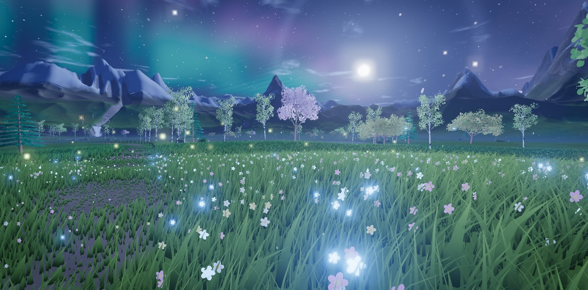

# 科学羊的世界 · Science Sheep’s World

**一本可以走进去的书，一个世界一个世界地往下写。**

由科学羊制作的浏览器 3D 互动世界。当前主体验是「草原之夜」：在湖边散步，听风、看萤火虫和极光，或潜入水潭，在海藻、珊瑚和沉船之间探索水下花园。

项目使用 Three.js / WebGL 渲染，HTML、CSS 与原生 JavaScript 构成交互界面，Web Audio 提供环境音与程序生成的音乐。无需安装游戏客户端，无需配置后端、数据库或 API Key。

## 湖底花园的开源来源 · Underwater garden credits

**湖底花园基于 [Abyssal Garden](https://github.com/Noniv/abyssal-garden) 的开源代码移植和改编，原作者为 Maksymilian Dendura（GitHub：[Noniv](https://github.com/Noniv)），原项目采用 MIT 许可。**

我们复用了原项目的程序化建模与数学工具，以及合成水下音景代码，包括海藻分布、珊瑚、岩石、沉船、石鲸尾、鱼群和蝠鲼等生成逻辑。湖底花园的这些基础内容应归功于原作者。

本项目在此基础上，将相关逻辑适配到草原现有的 **Three.js / WebGL** 场景，集成湖底布局、光照、实例化渲染、下潜和返回岸边交互、游泳与相机状态，以及共用音频上下文。原项目独立的 WebGPU 渲染器和页面导航没有直接搬入本项目。

**The underwater garden is adapted from [Abyssal Garden](https://github.com/Noniv/abyssal-garden) by Maksymilian Dendura (Noniv), licensed under MIT.** Its procedural geometry, kelp distribution, math helpers and synthesized soundscape form the basis of the underwater experience. This project integrates and adapts that work into the meadow's Three.js / WebGL scene, with lake-specific placement, lighting, diving, swimming, camera and audio integration. Credit for the original underwater work belongs to its author.

原始版权声明和 MIT 许可全文保留于 [`meadow/abyssal/LICENSE`](meadow/abyssal/LICENSE)。文件对应关系与改动说明见 [`meadow/abyssal/README.md`](meadow/abyssal/README.md) 和 [第三方说明](THIRD_PARTY_NOTICES.md)。本项目的自有内容声明不会替代或限制这部分上游代码及其改编代码的 MIT 许可。



## 可以体验什么

- **自由探索**：草原、湖泊、溪流、瀑布、雪山与海边，支持步行、奔跑、跳跃和游泳。
- **水下花园**：从湖岸下潜，探索海藻、珊瑚、鱼群和沉船，再返回岸边。
- **变化的自然**：昼夜、四季、天气、月相、星空、极光和萤火虫。
- **多种观看方式**：第一 / 第三人称、地图传送、上帝视角与自动漫游。
- **声音与旁白**：环境音、生成的摇篮曲、分句录音及字幕；支持临时导入自己的本地音乐。
- **可调画质**：低 / 中 / 高 / 极高档位、渲染缩放、性能面板和 60 秒自动漫游测试。
- **中英文界面**：从首页或场景入口切换语言。

仓库还保留了 `dino/` 恐龙图鉴和 `coast/` 海岸实验场景，未接入当前首页，也不在现有发布脚本的打包范围内。此前版本的宇宙篇不在当前源码中。

## 快速启动

### macOS：双击启动

1. 安装 Python 3，并下载或克隆本仓库。
2. 双击 `启动草原之夜.command`，脚本会启动仅本机可访问的服务并打开首页。
3. 点击「草原之夜」，等待世界生成后点击「进入」。

脚本会在 `8000–8010` 中选择可用端口，实际地址以终端输出为准。关闭启动终端后，后台服务仍会运行；需要停止时双击 `关闭草原之夜.command`。

也可以在项目根目录运行：

```bash
python3 tools/local_server.py start
python3 tools/local_server.py status
python3 tools/local_server.py stop
```

这套后台管理脚本面向 macOS / Unix 环境。

### 通用方式：静态 HTTP 服务

在终端中执行：

```bash
git clone https://github.com/Masir1128/MyWorld-yang.git
cd MyWorld-yang
python3 -m http.server 8080 --bind 127.0.0.1
```

Windows 如没有 `python3` 命令，可使用 `py -m http.server 8080 --bind 127.0.0.1`。

浏览器打开：

| 页面 | 本地地址 |
| --- | --- |
| 首页 | <http://127.0.0.1:8080/> |
| 草原之夜 | <http://127.0.0.1:8080/meadow/> |
| 恐龙图鉴（实验） | <http://127.0.0.1:8080/dino/> |
| 海岸（实验，依赖在线 CDN） | <http://127.0.0.1:8080/coast/> |

终端保持运行，按 `Control+C` 停止。请从**项目根目录**启动，以便场景加载共用的 `shared/` 引擎和资源。推荐通过 HTTP 访问；直接双击 HTML 的兼容路径不作为首选启动方式。

## 基本操作

| 按键 | 操作 |
| --- | --- |
| `W A S D` | 移动 |
| `Shift` / `Space` | 奔跑 / 跳跃 |
| 鼠标拖动 / 滚轮 | 环视 / 缩放 |
| `T` | 自动漫游 |
| `1–7` | 快速前往场景地点 |
| `M` / `G` | 地图 / 上帝视角 |
| `V` | 第一 / 第三人称 |
| `Y` / `R` | 切换季节 / 天气 |
| `B` / `J` | 音乐 / 旁白开关 |
| `H` / `P` | 隐藏界面 / 性能监控 |
| 湖岸按 `E` 或点击下潜按钮 | 进入水下花园 |
| 水下 `Space` / `C` 或 `Q` | 上浮 / 下潜 |
| 水下按 `E` | 返回岸边 |

湖泊结冰时无法下潜。更多选项见场景右侧设置面板；戴耳机体验更完整。

## 项目结构

```text
index.html                 首页
assets/                    封面与图标
meadow/                    草原主场景、角色模型、旁白录音
  diving.js                下潜与返回岸边的交互
  underwater.js            水下场景集成
  abyssal/                 水下程序化模型、音频与原始 MIT 许可
shared/                    共用 Three.js、附加模块、lil-gui 与离线引擎
dino/                      恐龙图鉴实验
coast/                     海岸实验
tools/                     启动、打包、旁白处理和水下测试工具
启动草原之夜.command       macOS 启动入口
关闭草原之夜.command       macOS 关闭入口
```

## 开发、验证与打包

运行页面不需要 Node.js 或 npm。执行已有的水下模块逻辑测试需要 Node.js：

```bash
node --experimental-default-type=module tools/test_underwater.mjs
```

该测试检查游泳状态、返回岸边与程序化网格等逻辑，画面和音频仍需在浏览器验证。

修改水下模块后，可重新生成直接打开 HTML 时使用的兼容文件：

```bash
python3 tools/build_underwater_offline.py
```

制作静态站点发布包（需要 zsh）：

```bash
zsh tools/build_site.sh
```

脚本会重建 `dist/` 和 `science-sheep-world.zip`，包含首页、草原、水下模块、共用引擎、角色模型与分句夜间旁白；不会自动上传或发布网站。这两项生成物不纳入 Git。

旁白编辑入口为 `tools/route_script.py`，使用 `python3 tools/build_script.py` 同步到页面及文案文件；已有录音的时长检测，以及拆分、标准化音频工具需要额外安装 FFmpeg / ffprobe。

## 运行与资源说明

- 推荐使用支持 WebGL 2 的现代桌面浏览器，并开启硬件加速。帧率取决于画质、分辨率、浏览器、设备和散热；先用默认画质，卡顿时降低画质或渲染缩放。
- 主场景引擎和角色模型已随仓库提供；部分资源保留在线备用地址。浏览器语音可用性取决于系统，缺失的录音可能回退到语音合成。
- 本地背景音乐、整段录音、内部商业方案、日志和本机状态不随仓库发布。背景音乐可使用程序生成的摇篮曲；临时导入音乐只在本机浏览器使用。
- `coast/` 使用在线 CDN。实验场景与主场景的支持范围不同，不代表每一条实验路径均已验收。

## 作者与许可

项目制作与集成：**科学羊 / Science Sheep** · GitHub：[@Masir1128](https://github.com/Masir1128)。湖底花园的上游作品作者为 **Maksymilian Dendura / Noniv**，具体致谢见上方来源说明。

仓库公开用于展示与交流。自有代码、文案、录音与视觉素材沿用页面中的「保留所有权利」声明，当前未额外授予通用开源许可；公开可见不代表可任意商业使用。

第三方组件和素材分别适用其原有许可，包括 Three.js、lil-gui、Abyssal Garden、KayKit 和 Quaternius。详见 [THIRD_PARTY_NOTICES.md](THIRD_PARTY_NOTICES.md)，原始许可证保留在对应目录。
